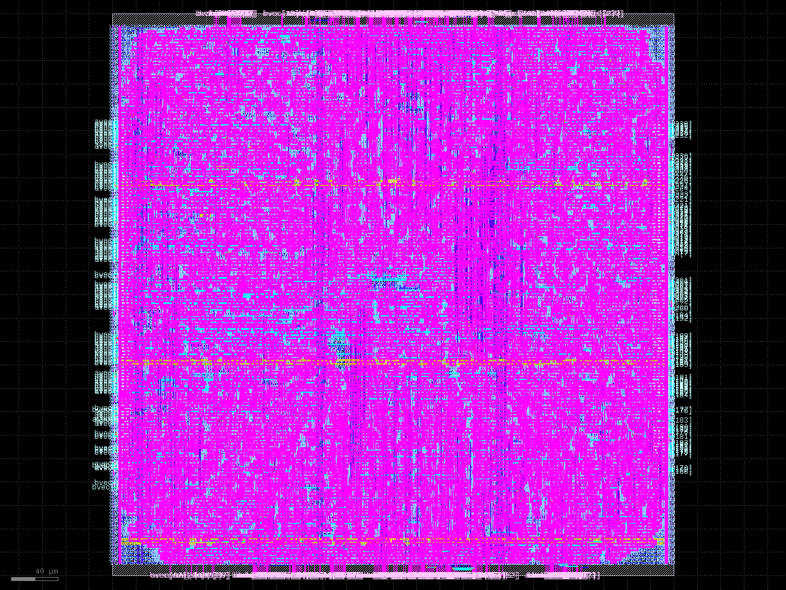

<p align="center">
  
</p>

<h1 align="center">MobileLLM-125M Decoder Chip — vibe-coded silicon</h1>

<p align="center"><sub>Part of <a href="https://github.com/Team-RocketEDA/RocketIDE"><b>RocketIDE</b></a> · demo project</sub></p>

A 100%-digital MobileLLM-125M decoder (`L=30/H=576/GQA-kv3/SwiGLU/RMSNorm/RoPE`),
designed and verified block by block as an agentic coding demo, with a first block
taken through place-and-route to GDS. Everything below is real: every number was measured in this repo, every waveform captured
from simulation, the GDS drawn by an open-source P&R flow on the sky130A PDK.

Built with **Muse Spark 1.3** through the **rocket-engine MCP**.



*First layout: `mac_array` (P=32) placed and routed in sky130A —
12,401 cells, 13,915 nets, 485,719 shapes, zero DRC. Full-chip GDS waits
on the stitching; the hierarchy above the leaves is still structural.*

## What this is

The repo retargeted from ALBERT to a **MobileLLM-125M decoder** (repo name
predates the switch and will be renamed). Contract-first, weight-stationary,
INT8 datapaths with Q8.8/Q4.12 fixed-point islands:

- `src/components/` — parametric RTL (`data_bit_width` everywhere, Yosys
  infers `+`/`-`/`*`, muxes are `if`/`case`)
- `architecture/` — the human-readable contract: hierarchy docs plus
  hand-rolled drill-down schematics ([top-level](architecture/mobilellm-top.html),
  [block tree](architecture/blocks-tree.html),
  [router](architecture/mobilellm-router.html), one page per block in
  [architecture/pages/](architecture/pages/))
- `weights/` — fetch script and manifest. The baked INT8 tables and goldens in
  `weights/bake/` (272 tensors verified from the finetuned safetensors) are local
  and gitignored. Provenance: `facebook/MobileLLM-125M` is gated (needs a
  license accept), so `weights/fetch_weights.sh` pulls the public finetune
  `h0ssn/MobileLLM-125M-e3.9.24.4.2-Agnews` instead (base architecture,
  shifted weights) — say "finetuned checkpoint", never "base model",
  until a base re-bake lands
- `src/sim_verilator/` — readable Verilator benches with Surfer waveforms
- `src/synth/mac_array/` — one-config LibreLane flow to GDS
- `renders/` — committed demo goldens (GDS + screenshot)

## How to test and verify

ASSUMPTION: `rocket-engine` is cloned as a SISTER folder of this repo
(`../rocket-engine`) and fully provisioned (its
`scripts/provision_toolchain.sh --install`) before running anything here.
Every tool resolves from it — iverilog/verilator/yosys/sby from its
oss-cad-suite, klayout from its tools dir, Python (cocotb, gdsfactory,
pytest) from its `.venv` — with Magic as the one exception (your source
build on PATH, canonical). Override with `RE_ROOT=/path/to/rocket-engine`;
`PDK=` for the sky130A root. Nothing in this repo carries a machine path.

You need Icarus Verilog, Verilator, Yosys and SymbiYosys, LibreLane for the GDS
flow, and Surfer for waves. Every command runs from the repo root.

One driver, no flag-fighting (`./build.sh`; run `./build.sh prereqs` first):

```sh
./build.sh prereqs          # check + list every prerequisite (PDK via $PDK or well-known paths)
./build.sh test             # elab + contract tests + stitch TBs + Verilator benches (default: all)
./build.sh test embed       # one bench: embed rmsnorm inproj top prompt (or one stitch TB)
./build.sh gds              # all 37 blocks, ONE AT A TIME, small first (OOM-safe)
./build.sh gds mac_array    # one block: mac_array lm_head embed_top outproj_tile
                            # rmsnorm_stage attention_core ffn_tile layer0..layer29
./build.sh gds clean        # wipe all out/<TAG>/, then run everything (clean slate)
./build.sh gds clean mac_array  # wipe + rerun one block
./build.sh clean            # sim/build outputs only (never weights/, never tiles/)
```

GDS runs are resumable: a tile with a finished `.gds` under
`src/synth/<block>/out/<TAG>/` is skipped (`DONE — skip`), so an
interrupted `gds all` picks up where it stopped. `--tag=NAME` selects
the output tag (default `v1_2d`); `clean` wipes `out/<TAG>/` for the
selection first. The committed assembly set lives in `tiles/` (see
`tiles/README.md`). The top-level `mobilellm_top` is simulation-only —
it is never pushed flat through LibreLane; silicon comes from stitched
block GDS (see Status).

| Gate | Command | Current status |
|---|---|---|
| Architecture contract | `python3 -m unittest discover -s architecture/tests` | 52 pass, 7 skip (tools or local files absent; run `-v` for reasons) |
| Elaboration | `bash src/scripts/elab.sh` | ELAB-OK |
| Unit sims (per block) | `iverilog -g2012 -s <tb> src/components/*.v src/tb/<...>.v && vvp a.out` | all PASS |
| Verilator tokens | `make -C src/sim_verilator embed` | `EMBED_VLT PASS (8 ids)`, byte-exact |
| Prompt test | `make -C src/sim_verilator prompt PROMPT_IDS="1 2 0x42"` | token ids in, vectors out, `waves_prompt.fst` |
| Dashboard | `python3 src/sim_verilator/dashboard.py` | `renders/dashboard.html` — live transcripts + GDS + links |
| Verilator norms | `make -C src/sim_verilator rmsnorm` | `RMSNORM_VLT PASS (576 lanes, tol=3 LSB)`; needs local `weights/bake/` |
| Verilator top smoke | `make -C src/sim_verilator top` | builds, 29 modules (outputs float: top is structural) |
| Formal proofs | `sby -f src/tb/rmsnorm_d/rmsnorm_d.sby` | PASS, 7m28s |
| Regressions | `tb_dotK_k128`, `tb_mac_array_p32` | PASS at shipped defaults |
| Synth + P&R | config in `src/synth/mac_array/` | GDS, zero DRC (see below) |

Waves land next to the benches — open them in Surfer:

```sh
surfer src/sim_verilator/waves_embed.fst    # token_id -> vec
surfer src/sim_verilator/waves_rmsnorm.fst  # x, gamma -> y, y_valid
surfer src/sim_verilator/waves_top.fst      # ids_in, pred_out, done
```

The terminal transcript is the readable reference (every input printed
with its output); the FST is the inspectable proof.

Weights are gated Meta files: put your `HF_TOKEN` in the environment and
run `weights/fetch_weights.sh`. The bake script and its output in `weights/bake/` are
not committed, so benches that read them (`rmsnorm`, `tb_rmsnorm_d`) need a local bake.
Weight binaries are never committed; `renders/` keeps one demo GDS.

## Benchmarks (all measured here)

**Synthesis to sky130_fd_sc_hd (tt), yosys 0.62:**

| Block | Cells | ABC time |
|---|---|---|
| `mac_unit` | 528 | <1 s |
| `mac_array` P=32 (shipped default) | 12,401 | 52 s (Booth-recoded; unrecoded never converged in 20+ min) |
| `dotK` K=128 (shipped default) | 48,939 | 31 min single-threaded |

**Place & route (`mac_array`, OpenROAD 2026-02-17, 480x480 um die):**
13,915 nets, 363,757 um routed wire, utilization 0.47, **zero DRC
violations**, GDS 33 MB with 485,719 shapes across 24 layers.

**Verification:** contract tests (52 pass, 7 skip on a clean clone), full-domain LUT sweeps (65,536
codes vs Python oracle), K=128/P=32 default-parameter regressions,
rmsnorm formal proof PASS.

## How rocket-engine helped

The engine is what makes vibe-coding a chip tractable instead of a
thousand lost files:

- **Project format** (`src/project.yaml`, `.rocket/` ledger) — every
  module has a doc contract and an RTL path; the ledger records each
  plan, proof, and bake as an event, so any agent (or human) can pick up
  exactly where the last one stopped.
- **Contracts first** — `architecture/blocks/*.md` are the source of
  truth; the HTML schematics are hand-rolled views of the same contracts,
  with typed I/O on every port before any logic was written.
- **Elaboration gate** (`src/scripts/elab.sh`) — the wiring-only skeleton
  elaborates clean at every step, so integration never rots while leaves
  are implemented in parallel.
- **One-config silicon** — `src/synth/mac_array/config.json` is the whole
  tapeout flow: PDK, corners, die size. LibreLane Classic does the rest;
  the repo keeps no TCL except two tiny stage scripts.

## Status and next steps

- DONE: leaf logic + unit sims + formal proofs + default-parameter
  regressions + Verilator benches with waves + first block GDS.
- NEXT: the top is now an unrolled etched chain (embed -> 30-deep
  `decoder_etched_stack` -> head, no loopback; each layer macro carries
  its baked weights). Per-block GDS via `./build.sh gds` into `tiles/`,
  then stitch (`./build.sh stitch`, KLayout batch) abuts the 32
  top-level macros (embed + 30 layers + head) into
  `tiles/mobilellm-125m.gds` — v1 places and merges; top wiring follows
  per `architecture/pins.json`. Then: full-model Verilator run,
  Sky130 signoff steps (CTS, PDN, LVS).

## Mini-roadmap (direction of record)

DOD: a full GDS with every weight etched as vias, plus a Verilator
waveform sim showing correct token computation. Tokenization stays
in Python (`weights/tokenize.py`) — out of RTL scope. So: text in,
text out is proven in sim; the GDS of everything is the deliverable;
golden GDS is committed to the repo (no releases).

0. **RTL == model.** Correct and behaving mathematically and
   behaviourally 1-to-1 with MobileLLM-125M (see the checkpoint
   config: L=30/H=576/GQA-9Q-3KV/FF=1536/SwiGLU/RMSNorm/RoPE).
   Gate: component goldens + head-oracle match on the etched stack.
1. **Ship a schematic.** Yosys netlist schematic (SVG/HTML) of the
   top-level LLM into this README, so the digital blocks are visible
   even before silicon shots land.
2. **LibreLane GDS, trunk + dev.** Trunk: SRAM-capable RTL with
   macros blackboxed (LVS waived) — one MAC tile GDS first, then
   every non-weight tile, then merge; const-register synthesis is
   the cheap gate before any of it. Dev branch: de-SRAM for the
   via-ROM transfer — placement script on one MAC tile proven
   against a numpy reference, then 30x1 replication, then the full
   layer macro, then stitch. Preferred end state: separately
   synthesized GDSes abutted, weights as via-ROM post-processing.
3. **Commit the golden GDS.** That commit is the demo. DOD: tokens
   in/out verified mathematically against the software model, LVS
   clean on the final GDS via netgen, timing closed at least.

## Roadmap

Done criteria per step: the artifact listed is committed, or the
named command passes. Steps are ordered; each is one PR.

### Done

- [x] RTL 1-to-1 with the model — audited dims, GQA, SwiGLU,
  RMSNorm, RoPE, causal mask, no bias, untied embed/head, final
  norm wired (`d62b6f2`).
- [x] `mac_array` tile synthesized to GDS — committed with shot.
- [x] Weight translation — per-channel int8 bake + scales + Q8.8
  norms + RoPE, all committed.
- [x] Tokenizer bridge + talking-bot test — code committed.
- [x] LibreLane-via-adapter path with manual PDK — code committed.
- [x] gdsfactory 9.51 in the albert venv.
- [x] readmemh hygiene gate (`check_synth_hygiene.py`).

### Blocked

- [ ] Full-model Verilator proof — needs a bigger machine than this
  31 GB box (build OOMs here; bench itself is ready). Done when
  `make -C src/sim_verilator top` prints `TOP_VLT PASS`.

### Next (in order)

- [ ] Literal emitter — hex → per-tile `localparam`. Done when
  `--strict` hygiene passes with zero grandfathered sites.
- [ ] Trunk checkpoint 1: single-MAC GDS, SRAM blackboxed.
  Done when the GDS + DRC-clean report are committed.
- [ ] Non-weight tiles synth + merge. Done when every tile dir has
  a committed GDS.
- [ ] Via-ROM generator + LEF/LIB/stubs. Done when via count equals
  popcount(hex) on smallest and largest macro.
- [ ] One-tile via proof vs numpy. Done when the tile TB matches
  the software reference.
- [ ] 30x1 abutment, then full layer macro. Done when the seam DRC
  on 2 stamps is clean.
- [ ] Top assembly + LVS (netgen) + timing closure. Done when LVS
  is clean and STA closes.
- [ ] Yosys netlist schematic (SVG/HTML) embedded in this README.

### Open questions

- [ ] N=16 lock-in.
- [ ] `u_wlm` deletion verify; `loop_mem_seq` prune.
- [ ] Wire the bound stack (`emit_stack.py` output) into the top.
- [ ] Activation-scale calibration (unit chain vs baked scales).
- [ ] DOD oracle vehicle: numpy vs HF python.

### Housekeeping

- [ ] Prune dead loop-era files (`tb_loop_top_stitch`, `obj_loop`
  targets, `dram_ctrl.v` if uninstantiated, `run_librelane.py` vs
  `run_tile.py` duplication).
- [ ] Refresh `renders/dashboard.html` + waves after the full-model
  pass (still shows the retired loop sim).
- [ ] Per-buffer macro mapping (PDK 1k/2k vs stub) from the §13
  touch map. Rule of record: read-only + const-valued ⇒ via-ROM
  etch (never a macro); anything dynamically written ⇒ register
  file or SRAM macro.
