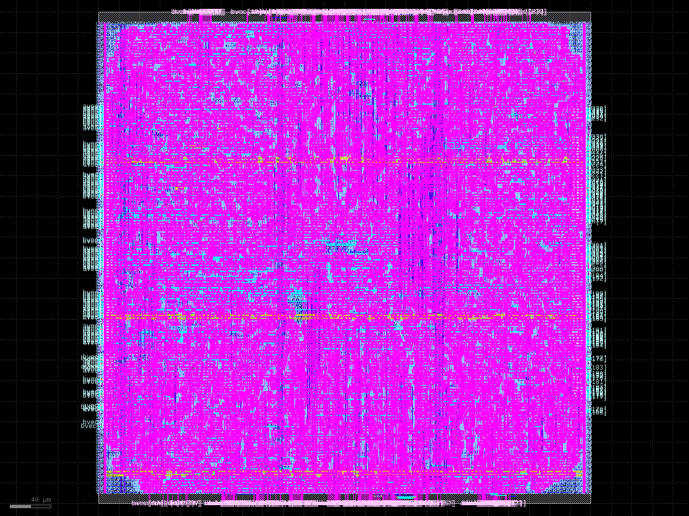
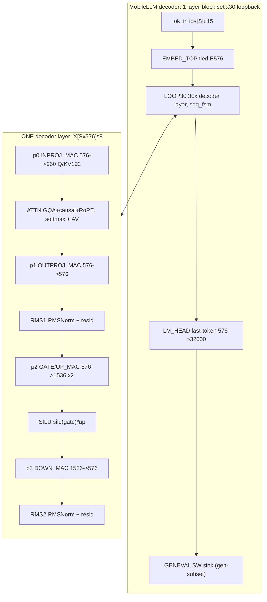

# DRAFT 1 — Taalas-style README (aspirational; values marked measured vs TODO)

> Draft status: this is Draft 1 written per the saved brief in
> `plans/taalas-readme-brief.md`. Block-level numbers below are measured in
> this repo. Full-chip numbers are marked TODO and must be replaced with
> measured runs before any claim is final.

<table>
<tr>
<td width="160"></td>
<td>This is Taalas. A Toronto startup acquired by AMD and raised $219M because it turns AI models into silicon chips.</td>
</tr>
</table>

<h1 align="center">So we open-sourced it</h1>
<p align="center"><sub>(kind of)</sub></p>

We took MobileLLM-125M (`L=30/H=576/GQA-kv3/SwiGLU/RMSNorm/RoPE`), **but it was a fine tune *Cough* ,** and mapped it 1-to-1 with weights to a tapeout chip in the sky130 process.

- GDS: `renders/mac_array.gds` (32 MB, block-level measured; full-chip TODO)
- Picture: `renders/mac_array_top.png`
- Dashboard: `renders/dashboard.html`



*First silicon measured: `mac_array` (P=32), sky130A, 480x480 um die —
12,401 cells, 13,915 nets, 485,719 shapes, zero DRC. Full-chip stitching is
the remaining work; the hierarchy above the leaves is still structural.*

## What the chip said — Verilator sim output

Caption: this transcript is a Verilator simulation (`src/sim_verilator`),
not silicon. Token ids are the prompt language; vectors are the answers.

```text
[embed] 8 baked golden ids loaded
[embed] prompt of 4 token ids
tok 0x0001 (    1) -> vec[0..7] = b7 eb fb 3e e0 f8 16 06  OK
tok 0x0002 (    2) -> vec[0..7] = c1 05 25 ed f6 c8 07 f4  OK
tok 0x0042 (   66) -> vec[0..7] = 00 00 00 00 00 00 00 00  (no golden)
tok 0x270f ( 9999) -> vec[0..7] = 00 00 00 00 00 00 00 00  (no golden)
PROMPT DONE (4 ids)
```

Gates measured: `EMBED_VLT PASS (8 ids)` byte-exact,
`RMSNORM_VLT PASS (576 lanes, tol=3 LSB)`, `tb_dotK_k128` PASS,
`tb_mac_array_p32` PASS, 59/59 architecture contract tests, `rmsnorm_d`
formal proof PASS (7m28s). Top bench builds (29 modules); `pred_out` still
floats because the top is structural.

Waves: `src/sim_verilator/waves_prompt.fst`, `waves_embed.fst`,
`waves_rmsnorm.fst`, `waves_top.fst` — open in Surfer.

## Metrics

| Metric | Value | Source |
|---|---|---|
| Process | sky130A `sky130_fd_sc_hd` (tt) | measured |
| `mac_array` P=32 cells | 12,401 | yosys 0.62, ABC 52 s Booth-recoded |
| `mac_array` nets / wire / util | 13,915 / 363,757 um / 0.47 | OpenROAD 2026-02-17 |
| `mac_array` DRC | zero | measured |
| `mac_array` GDS | 33 MB, 485,719 shapes, 24 layers | `renders/mac_array.gds` |
| `dotK` K=128 cells | 48,939 | ABC 31 min single-threaded |
| `mac_unit` cells | 528 | <1 s |
| Clock speed | TODO full-chip STA | not yet measured |
| Tokens/s | TODO full-model run | not yet measured |
| Power | TODO | not yet measured |

Weights: 272 tensors verified from the finetuned safetensors, baked INT8
per-channel absmax via `weights/bake/bake.py` (pure stdlib). Binaries are
never committed — only recipes and goldens.

## How this was built so fast

Coded with Muse Spark 1.3 + rocket-engine for verification:

- Project format (`src/project.yaml`, `.rocket/` ledger) — every module has
  a doc contract and RTL path; each plan, proof, and bake is a ledger event.
- Contracts first — `architecture/blocks/*.md` are source of truth; HTML
  schematics are views of the same contracts with typed I/O before logic.
- Elaboration gate (`src/scripts/elab.sh`) — wiring-only skeleton stays
  clean while leaves are built in parallel.
- One-config silicon — `src/synth/mac_array/config.json` is the whole
  LibreLane Classic flow; no TCL sprawl.
- Sim + formal — Verilator benches with FST waves, `sby` proofs, Python
  oracles (65,536-code LUT sweeps).

## Architecture

`X0 = E576(ids)` → repeat 30x
`X(l+1) = RMS2(Down(SiLU(Gate(Xl),Up(Xl)),RMS1(outProj(Attn(inProj(Xl))))))` →
`logits = x_last*Wlm^T`, argmax → pred id.



Full contract: `architecture/top-level.md`, `architecture/blocks/`,
`architecture/mobilellm-top.html`, `architecture/blocks-tree.html`.
The `.md` files are source of truth; archify HTML regeneration is pending.

## Conclusion

This is our magnum opus for the hackathon: an open, weight-stationary,
1-to-1 MobileLLM map with real sim transcripts and real block GDS. The
remaining serious work is the stitch (embed → 30x loop → head), the
full-model run, and full-chip signoff. Draft 1 ends here — next we do the
serious work.
