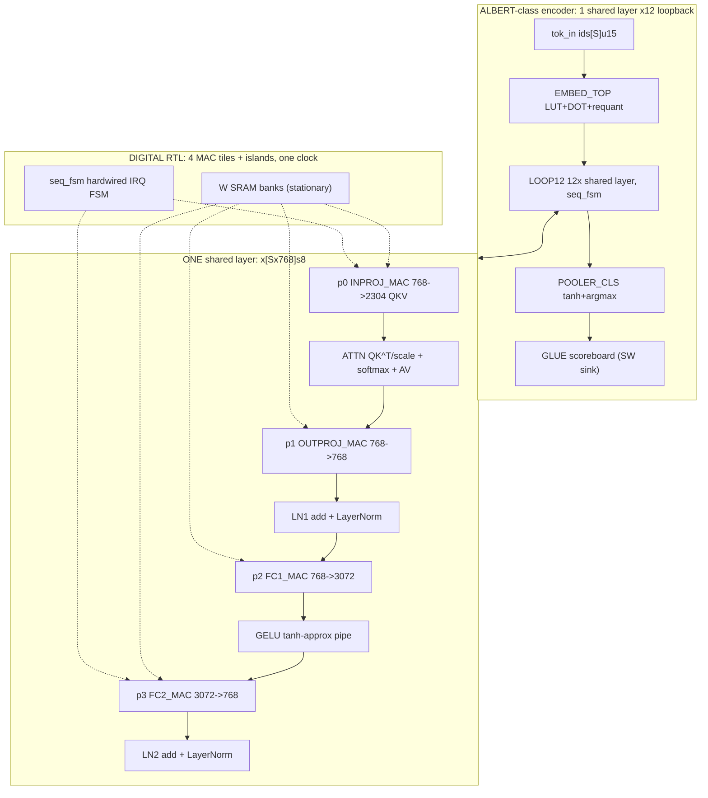

# ALBERT-class Encoder — Pure-Digital RTL Architecture

Functional spec: `s41467-025-63794-4.md` (ALBERT-base math, 12x shared layer,
4 FC blocks >99% weights). Implementation vehicle: 100% digital RTL, parametric
`data_bit_width`, weight-stationary SRAM, tokens streamed via FIFOs.
No analog, no PCM, no ADC/DAC (mixed-signal side quests live out-of-repo and
are NOT this package). Open-weight vehicle (Meta only):
`facebook/MobileLLM-125M` (see `DEEP_RESEARCH_tiny-models.md`);
sim proxy scales dims down on the same RTL.
Status: proof-of-concept only. Interactive diagram: `albert-top.html`
(regeneration via archify finalize pending — .md is source of truth).

## L0 block diagram

Signal path: `X0 = Wproj*E128(ids)` → repeat 12x
`X(l+1) = LN2(FC2(GELU(FC1(LN1(outProj(Attn(inProj(Xl))))))))` →
`logits = Wcls*tanh(Wpool*X12[0]) + b`, compare vs labels.

## Block table (math + I/O + widths)

| Block | Math | I/O | Home |
|---|---|---|---|
| tok_in (SW stim) | ids = Tok(text) | text -> `[S]u15` | SW testbench |
| EMBED_TOP | `X0 = requant(Wp*E128(ids)+b)` | `[S]u15 -> [Sx768]s8` | DIG RTL `embed.gds` |
| p0 INPROJ_MAC | `Y = X*W^T`, `W:[2304x768]`, split Q/K/V | `[Sx768]s8 -> [Sx2304]s8` | DIG RTL tile (`mac_array`+SRAM) |
| ATTENTION_CORE | `A = softmax(QK^T/sqrt64)*V`, `O(S^2*64/head)` | `[Sx2304]s8 -> [Sx768]s8` | DIG RTL `attn.gds` |
| p1 OUTPROJ_MAC | `Y = X*W^T`, `W:[768x768]` | `[Sx768]s8 -> [Sx768]s8` | DIG RTL tile (`mac_array`+SRAM) |
| LAYERNORM x2 | `y = g*(x-u)/s + b`, residual add first | `[Sx768]fxp16` | DIG RTL `ln.gds` |
| p2 FC1_MAC | `H = X*W1^T+b1`, `W1:[3072x768]` | `[Sx768]s8 -> [Sx3072]s8` | DIG RTL tile (`mac_array`+SRAM) |
| GELU pipe | `GELU(h) = h*Phi(h)`, tanh approx | `[Sx3072]fxp16` | DIG RTL `gelu_pipe.gds` |
| p3 FC2_MAC | `Y = H*W2^T+b2`, `W2:[768x3072]` | `[Sx3072]s8 -> [Sx768]s8` | DIG RTL tile (`mac_array`+SRAM) |
| POOLER_CLS | `h = tanh(Wp*x+b)`, `logits = Wc*h` | `768 -> 768 -> 2 (3 MNLI)` | DIG RTL `head.gds` |
| LOOP_MEM_SEQ | 12x loopback, FIFOs, SRAM banks | control + SRAM | DIG RTL `seq.gds` |
| Weights (Wemb/Wp/W/b/gamma/beta) | pinned once, never move | SRAM macros | DIG SRAM (OpenRAM) |
| GLUE compare | accuracy vs HF golden + labels | `logits[16b] -> hits/total[32u]` | SW scoreboard (sink) |
| seq_fsm | hardwired phase/IRQ sequencer, NO RV32 | `irq -> phase_sel/addrs/fifo_rd` | DIG RTL (ADR-0001; `mcu_fw.c` = golden C model) |

## Dataflow rule (locked)

WEIGHT-STATIONARY always. Weights pinned in per-tile SRAM banks, never move.
Token vectors stream in through input FIFOs; partial sums accumulate in
accumulator regfiles; results stream out through output FIFOs. All ports are
digital bit-vectors + valid/ready. One physical layer-block set is reused 12x
via loopback. Full contract: [blocks/09-interface.md](blocks/09-interface.md).

### Phase → block order (paper L58, locked)

| Phase | Block | Lanes in | Lanes out |
|---|---|---|---|
| p0 | INPROJ X→QKV | 0-1 | 0-4 |
| p1 | OUTPROJ | 0-1 | 0-2 |
| p2 | FC1 | 0-1 | 0-5 |
| p3 | FC2 | 0-5 | 0-1 |

Lane groups time-mux the digital MAC tiles over chunks; phases never overlap;
frame order `p0→p1→ATTN_WAIT→LN1→p2→GELU_WAIT→p3→LN2→LOOPBACK→RECAL_CHECK`
(now a requant-coeff check — no PCM drift exists). Detail:
[blocks/09-interface.md](blocks/09-interface.md).

## RNN contrast (Fig1a lock)

Elman `h_t = phi(Wxh*x_t + Whh*h_{t-1} + b)`; LSTM 4-gate; GRU 3-gate;
unrolled `h_t = f_theta(x_t,h_{t-1})` with tied theta (analogous to ALBERT's
12x weight tie); attention replaces recurrence with `A = softmax(QK^T/sqrt d)V`.

## Demo plan (Nov 4)

1. SHIP: 1-layer proxy digital sim (L=1,H=32,ff=64,S=8,int8,
   ~12K params, ~70K MACs) in iverilog from `$readmemh` — ~6 s serial,
   sub-second with an 8-wide MAC array, no VCD. Text in → tokens out.
2. STRETCH: full MobileLLM-125M (124.6M, 30 layers; exact MAC budget from
   opened config at bring-up, PARAMS §9) under Verilator (30–100x) +
   parallel MAC array; gen-subset compare table vs HF golden.
3. REFERENCE: ALBERT-base math stays the functional spec (this doc);
   open weights come from Meta only (MobileLLM-125M); proxy dims ride the
   same parametric RTL.
   Numbers: [DEEP_RESEARCH_tiny-models.md](../DEEP_RESEARCH_tiny-models.md).

## Open items (scope notes, not blockers)

- No live sim run yet beyond `rtl/embed` (EMBED PASS); inProj MAC + seq_fsm
  RTL next in BUILD_MAP order.
- HF-config + `AlbertLayerNorm` reverify, requant sweeps, S=64 full-frame run:
  PARAMS §9 (bring-up checklist).
- albert-top.html / candidate.json refresh via archify finalize pending
  (no archify CLI on this machine) — .md files are the contract source.
