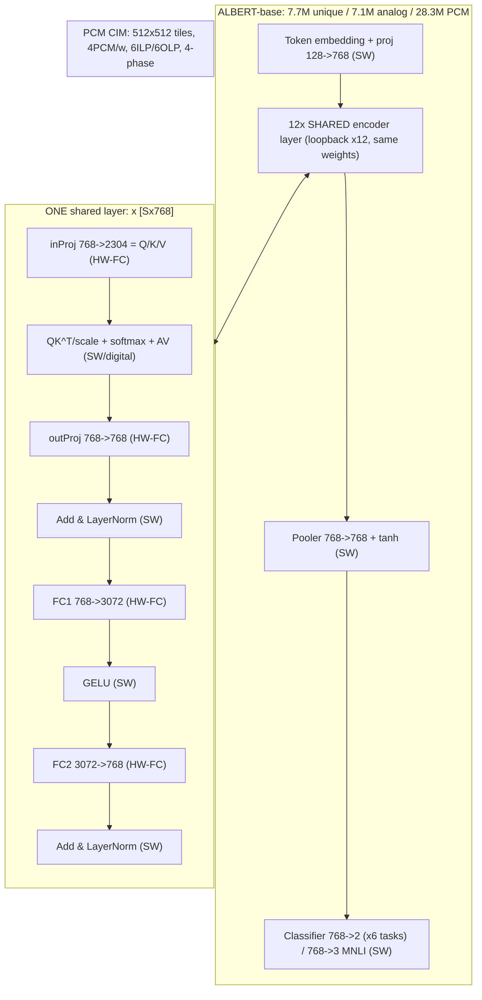

# ALBERT Analog Inference — Top-Level Architecture (theoretical demo)

Paper: `s41467-025-63794-4.md` (14 nm PCM CIM, ALBERT-base, 12 shared layers).
Status: proof-of-concept only. Dims below are paper reference values; the demo
proxy runs smaller S and fewer columns. Interactive diagram: `albert-top.html`.

## L0 block diagram

Signal path: `X0 = Wproj*E128(ids)` → repeat 12x
`X(l+1) = LN2(FC2(GELU(FC1(LN1(outProj(Attn(inProj(Xl))))))))` →
`logits = Wcls*tanh(Wpool*X12[0]) + b`, compare vs labels.

## Block table (math + I/O)

| Block | Math | I/O | Home |
|---|---|---|---|
| Embed + proj (SW) | `X0 = Wproj*E128(ids)` | `[S] -> [Sx768]` | digital/SW |
| inProj (HW-FC) | `Y = X*W^T`, `W:[2304x768]`, split into Q,K,V | `[Sx768] -> [Sx2304]` | analog tile |
| Attention core (SW) | `A = softmax(QK^T/sqrt64)*V`, `O(S^2*64/head)` | `[Sx2304] -> [Sx768]` | digital |
| outProj (HW-FC) | `Y = X*W^T`, `W:[768x768]` | `[Sx768] -> [Sx768]` | analog tile |
| LayerNorm (SW) | `y = g*(x-u)/s + b`, residual add first | `[Sx768]` | digital |
| FC1 (HW-FC) | `H = X*W1^T+b1`, `W1:[3072x768]` | `[Sx768] -> [Sx3072]` | analog tile |
| GELU (SW) | `GELU(h) = h*Phi(h)`, tanh approx | `[Sx3072]` | digital |
| FC2 (HW-FC) | `Y = H*W2^T+b2`, `W2:[768x3072]` | `[Sx3072] -> [Sx768]` | analog tile |
| Pooler/cls (SW) | `h = tanh(Wp*x+b)`, `logits = Wc*h` | `768 -> 768 -> 2 (3 MNLI)` | digital |
| Codec (HW) | duration-encode rows, 7-bit OLP digitize | vec <-> pulse train | analog tile |
| Loop/MCU (SW) | 4-phase seq, calib + drift tables | control + SRAM | digital |

## Dataflow rule (locked)

WEIGHT-STATIONARY always. Weights pinned in tiles, never move. Token vectors
stream in through input FIFOs at the landing pads (512-elem duration vectors),
partial sums accumulate in place, results stream out through output FIFOs.
One physical layer-block set is reused 12x via loopback. Analog and digital
areas never share a layout; they meet at tile I/O (FIFOs) and at the top-level
compare table. Full contract: [blocks/09-interface.md](blocks/09-interface.md).

### Phase → block order (paper L58, locked)

| Phase | Block | ILP lanes | OLP lanes |
|---|---|---|---|
| p0 | INPROJ X→QKV | 0-1 | 0-4 |
| p1 | OUTPROJ | 0-1 | 0-2 |
| p2 | FC1 (analog-pair sum, one digitization) | 0-1 | 0-5 |
| p3 | FC2 (6x separate digitize + digital accum) | 0-5 | 0-1 + half-share |

Mesh rules: ILP enters tile WEST sides; OLP leaves SOUTH/NORTH; 2x256 implicit
concat into OLP; no-crossing; phases never overlap; tile groups ordered in
phase order; the 2 white squares (no tiles/mesh) are hard keep-outs — FC2's
6-wide corridor stays clear of them. Detail: [blocks/09-interface.md](blocks/09-interface.md).

## RNN contrast (Fig1a lock)

Elman `h_t = phi(Wxh*x_t + Whh*h_{t-1} + b)`; LSTM 4-gate; GRU 3-gate;
unrolled `h_t = f_theta(x_t,h_{t-1})` with tied theta (analogous to ALBERT's
12x weight tie); attention replaces recurrence with `A = softmax(QK^T/sqrt d)V`.

## Demo plan (Nov 4)

1. SHIP: tiny sky130 analog MAC or bandgap tile via
   `run_spice` + `run_drc` + `run_lvs` + `generate_views` (all fixtures live).
2. STRETCH: 1-layer ALBERT FC/outProj ngspice tile fed by HF `albert-base-v2`
   minus-last-layer hidden states; compare table (cosine/R2 vs SW, GLUE -1.8%
   budget ref, 4-bit sweep ref).
3. FALLBACK: pure-digital sky130 MAC sim+synth (GDS needs openroad re-proof).

## Open items (unresolved, affect reading)

- No figure image files in repo; Fig1c sizes, Fig1d CDF bins, Fig2h per-block
  tile counts are aggregates only (34 tiles / 79.4% / 512x512).
- Vocab 30000 / E=128 / 12 heads x64 are standard ALBERT-base (Lan et al.),
  not stated in this paper's text.
- Duration-encoding pulse params + 7-bit OLP transfer model assumed.
- No live sim run yet; torch/transformers install, sax_mzi qualification,
  openlayout deck location still unverified.
