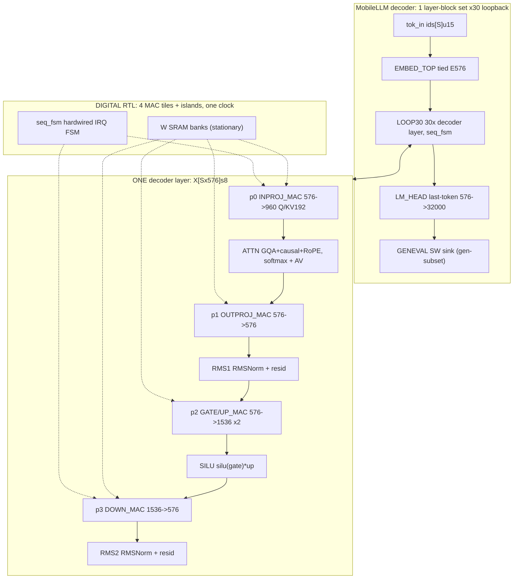

# MobileLLM-125M Decoder — Pure-Digital RTL Architecture

Origin: `s41467-025-63794-4.md` (ALBERT-base math, analog PCIM — the
project's starting point, not its vehicle). Implementation vehicle:
100% digital RTL, parametric `data_bit_width`, weight-stationary SRAM,
tokens streamed via FIFOs. No analog, no PCM, no ADC/DAC (mixed-signal
side quests live out-of-repo and are NOT this package). Open-weight
vehicle (Meta only): `facebook/MobileLLM-125M` (see
`DEEP_RESEARCH_albert-vs-mobilellm.md` for the switch study);
sim proxy scales dims down on the same RTL.
Status: proof-of-concept only. Interactive diagram: `mobilellm-top.html`
(regeneration via archify finalize pending — .md is source of truth).

## L0 block diagram

Signal path: `X0 = E576(ids)` → repeat 30x
`X(l+1) = RMS2(Down(SiLU(Gate(Xl),Up(Xl)),RMS1(outProj(Attn(inProj(Xl))))))` →
`logits = x_last*Wlm^T`, argmax → pred id, gen-subset compare vs HF golden.

## Block table (math + I/O + widths)

| Block | Math | I/O | Home |
|---|---|---|---|
| tok_in (SW stim) | ids = Tok(text) | text -> `[S]u15` | SW testbench |
| EMBED_TOP | `X0 = E576(ids)` tied lookup | `[S]u15 -> [Sx576]s8` | DIG RTL `embed.gds` |
| p0 INPROJ_MAC | `Y = X*W^T`, `W:[960x576]`, Q576 + K192 + V192 | `[Sx576]s8 -> [Sx960]s8` | DIG RTL tile (`mac_array`+SRAM) |
| ATTENTION_CORE | `A = softmax(QK^T/sqrt64+causal+RoPE)*V`, GQA 9Q/3KV, KV cache | `Q[Sx576]+K/V[Sx192]s8 -> [Sx576]s8` | DIG RTL `attn.gds` |
| p1 OUTPROJ_MAC | `Zout = Z*W^T`, `W:[576x576]` | `[Sx576]s8 -> [Sx576]s8` | DIG RTL tile (`mac_array`+SRAM) |
| RMSNORM x2 | `y = (x+r)/sqrt(mean((x+r)^2)+eps) * g`, no mean/beta | `[Sx576]s8 in -> [Sx576]fxp16` | DIG RTL `rms.gds` |
| p2 GATE/UP_MAC | `G = X*Wg^T`, `U = X*Wu^T`, `W:[1536x576]` each | `[Sx576]s8 -> [Sx1536]s8 x2` | DIG RTL tile (`mac_array`+SRAM) |
| SILU pipe | `H = silu(G)*U` LUT + mul | `[Sx1536]fxp16` | DIG RTL `silu_pipe.gds` |
| p3 DOWN_MAC | `Y = H*Wd^T`, `Wd:[576x1536]` | `[Sx1536]s8 -> [Sx576]s8` | DIG RTL tile (`mac_array`+SRAM) |
| LM_HEAD | `logits = x_last*Wlm^T` (32000 classes), argmax | `[576]s8 -> pred[15b]` | DIG RTL `head.gds` |
| LOOP_MEM_SEQ | 30x loopback, FIFOs, SRAM banks | control + SRAM | DIG RTL `seq.gds` (phase seq + FSM + FIFOs + coeff SRAM) |
| Weights (E576/Wqkv/Wo/Wg/Wu/Wd/g/Wlm) | pinned once, never move | DIG SRAM macros | DIG SRAM (OpenRAM), stationary, loaded once |
| GenEval compare | gen-subset accuracy vs HF golden | `pred ids -> matches/total` | SW scoreboard (sink) |
| seq_fsm | hardwired phase/IRQ sequencer, NO RV32 | `irq -> phase_sel/addrs/fifo_rd` | DIG RTL (ADR-0001; `mcu_fw.c` = golden C model) |

## Dataflow rule (locked)

WEIGHT-STATIONARY always. Weights pinned in per-tile SRAM banks, never move.
Token vectors stream in through input FIFOs; partial sums accumulate in
accumulator regfiles; results stream out through output FIFOs. All ports are
digital bit-vectors + valid/ready. One physical layer-block set is reused 30x
via loopback. Full contract: [blocks/09-interface.md](blocks/09-interface.md).

### Phase → block order (paper L58, locked)

| Phase | Block | Lanes in | Lanes out |
|---|---|---|---|
| p0 | INPROJ X→QKV | 0-1 | 0-4 |
| p1 | OUTPROJ | 0-1 | 0-2 |
| p2 | GATE/UP | 0-1 | 0-5 |
| p3 | DOWN | 0-5 | 0-1 |

Lane groups time-mux the digital MAC tiles over chunks; phases never overlap;
frame order `p0→ATTN→p1→RMS1→p2→SILU→p3→RMS2→LOOPBACK→RECAL_CHECK`
(requant-coeff check — no PCM drift exists). Detail:
[blocks/09-interface.md](blocks/09-interface.md).

## RNN contrast (Fig1a lock)

Elman `h_t = phi(Wxh*x_t + Whh*h_{t-1} + b)`; LSTM 4-gate; GRU 3-gate;
unrolled `h_t = f_theta(x_t,h_{t-1})` with tied theta (analogous to this
design's 30x layer-block reuse); attention replaces recurrence with
`A = softmax(QK^T/sqrt d)V` (+ causal mask + RoPE here).

## Demo plan (Nov 4)

1. SHIP: 1-layer proxy digital sim (L=1/H=32/ff=64/S=8,int8,
   ~12K params, ~70K MACs) in iverilog from `$readmemh` — ~6 s serial,
   sub-second with an 8-wide MAC array, no VCD. Text in → tokens out.
2. STRETCH: full MobileLLM-125M (124.6M, 30 layers; exact MAC budget from
   opened config at bring-up, PARAMS §9) under Verilator (30–100x) +
   parallel MAC array; gen-subset compare table vs HF golden.
3. REFERENCE: MobileLLM-125M config + training config + paper Table 9 stay
   the functional spec (this doc); open weights come from Meta only
   (MobileLLM-125M); proxy dims ride the same parametric RTL.
   Numbers: [DEEP_RESEARCH_tiny-models.md](../DEEP_RESEARCH_tiny-models.md),
   switch study: [DEEP_RESEARCH_albert-vs-mobilellm.md](../DEEP_RESEARCH_albert-vs-mobilellm.md).

## Open items (scope notes, not blockers)

- No live sim run yet beyond spikes (`MAC PASS`, `EMBED PASS` in
  `src/spikes/`); inProj MAC + seq_fsm RTL next in BUILD_MAP order.
- HF-config + RMS eps + tie-discrepancy reverify, requant sweeps, S=64
  full-frame run: PARAMS §9 (bring-up checklist).
- mobilellm-top.html / candidate.json refresh via archify finalize pending
  (no archify CLI on this machine) — .md files are the contract source.
